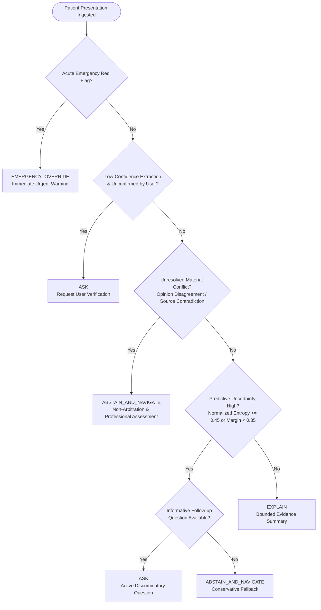

# MedResolve — Uncertainty-Aware Selective Action Policy Specification

## 1. Overview and Problem Formulation

In patient-facing AI health assessment and care navigation, a fundamental hazard is **diagnostic overconfidence and premature closure**: AI systems frequently hallucinate definitive diagnoses, arbitrate clinical disputes between independent clinicians, or generate assertive advice despite acute red flags, extraction errors, or deep epistemic ambiguity.

The MedResolve **Uncertainty-Aware Selective Action Policy** is an explicit, testable, and interpretable decision-theoretic policy that chooses between three ordinary action pathways:
- **`ASK`**: Proactively query the patient for targeted missing information or request verification of an uncertain automated document extraction (e.g., OCR or regex parser).
- **`EXPLAIN`**: Produce a bounded, evidence-grounded summary when clinical evidence is adequate, verified, and free from unresolved material conflicts.
- **`ABSTAIN_AND_NAVIGATE`**: Decline to make an unsupported diagnostic comparison, summarize unresolved evidence neutrally, and guide the patient toward qualified in-person medical evaluation.

Crucially, ordinary action selection is strictly subordinated to a deterministic **Emergency Safety Override (`EMERGENCY_OVERRIDE`)**, which intercepts presentations exhibiting acute cardiopulmonary, airway, or neurological red flags.

---

## 2. Policy Input Signals

The policy explicitly tracks separate, non-fungible signals to prevent false conflation between clinical abnormality, document processing error, and model ambiguity:

### 2.1 Predictive Diagnostic Uncertainty
Given the multi-class model probability simplex $\mathbf{p} = [p_1, p_2, \dots, p_C] \in \Delta^{C-1}$ over $C = 49$ DDXPlus pathologies:
- **Shannon Entropy**:
  $$H(\mathbf{p}) = -\sum_{c=1}^C p_c \log_2(p_c + \epsilon)$$
- **Normalized Shannon Entropy**:
  $$H_{\text{norm}}(\mathbf{p}) = \frac{H(\mathbf{p})}{\log_2(C)} \in [0.0, 1.0]$$
  (For $C = 49$, $\log_2(49) \approx 5.6147$).
- **Prediction Margin (Confidence Gap)**:
  $$\Delta = p_{(1)} - p_{(2)}$$
  where $p_{(1)}$ is the maximum predicted probability and $p_{(2)}$ is the second-highest predicted probability.

### 2.2 Extraction Uncertainty
- Tracked per evidence item in `EvidenceLedger`:
  - `extraction_method`: `DIRECT_SELECTION`, `OCR_EXTRACTION`, `RULE_BASED_PARSER`.
  - `extraction_confidence` $\in [0.0, 1.0]$: Character/token confidence from automated parsers.
  - `user_confirmation_status`: `UNCONFIRMED`, `CONFIRMED_BY_PATIENT`, `CONFIRMED_BY_CLINICIAN`.
- **Threshold**: Items with extraction confidence $< 0.70$ that remain `UNCONFIRMED` are flagged as requiring active clarification.

### 2.3 Observable Clinical Data Conflicts
Evaluated by the Phase 3 `RuleBasedConflictDetector`:
- `ENTERED_OPINION_DISAGREEMENT`: Two independent clinicians record divergent impressions.
- `SOURCE_STATEMENT_DISAGREEMENT`: Direct contradiction between patient self-report and clinical note.
- `VALUE_OR_UNIT_DISCREPANCY`: Clashing numerical values or missing incompatible units for the same observation window.
- `TEMPORAL_DISCREPANCY`: Chronological impossibilities (e.g., event timestamp recorded in the future).

### 2.4 Follow-Up Question Availability
- Candidate questions are mapped from `release_evidences.json`.
- A question is valid only if it targets an unasked concept and has a documented clinical phrasing (`question_en`).
- If no valid unasked question remains, question availability is strictly `None`.

---

---

## 3. Emergency Safety Override Engine & Safety Audit (Phase 4.1)

The urgent-warning safety override enforces deterministic clinical gating for time-critical presentations.

### 3.1 Audited Rule Set & Clinical Provenance
During the Phase 4.1 safety audit, all emergency override rules were audited to verify that inference decisions rely **strictly on information legitimately available to the running application** (i.e. observed clinical evidence and physiological vitals recorded in the `EvidenceLedger`). 

The detector strictly forbids:
- Reading ground-truth target pathology (`PATHOLOGY` or `DIFFERENTIAL_DIAGNOSIS`).
- Reading synthetic generator metadata flags (e.g. `metadata.is_acute_emergency`).
- Using diagnostic classifier probabilities (e.g., former Rule 7 which triggered on $P(\text{STEMI}) \ge 0.40$). Model probabilities are diagnostic inferences, not physiological triage red flags.

| Rule ID | Clinical Red-Flag Constellation | Observable Evidence Concepts | Clinical Provenance & Scope |
| :--- | :--- | :--- | :--- |
| **Rule 1** | Acute Upper Airway Obstruction & Laryngospasm | `E_194` (Inspiratory stridor) or `E_128` (Suffocating sensation / inability to breathe or speak) | Advanced Trauma Life Support (ATLS) Airway Assessment; acute upper airway compromise requiring immediate emergent intubation/intervention. |
| **Rule 2** | Acute Syncope / Sudden Loss of Consciousness | `E_159` (Loss of consciousness / syncope) or `E_43` (Syncope episode) | ACC/AHA/HRS Syncope Guidelines; unexplained loss of consciousness carrying acute cardiogenic or cerebrovascular risk. |
| **Rule 3** | Acute Cardiopulmonary Distress | Concurrent acute thoracic chest pain (`E_55_@_V_101`, `E_55_@_V_29`, `E_55_@_V_55`, `E_55_@_V_161`, etc.) AND acute resting dyspnea (`E_66`) | Emergency Department Triage Protocols (Manchester / ESI Level 1-2); potential Acute Coronary Syndrome, Pulmonary Embolism, or Tension Pneumothorax. |
| **Rule 4** | Gross Upper Gastrointestinal Hemorrhage | `E_210` (Coffee-ground emesis or gross hematemesis) | American College of Gastroenterology (ACG) Acute GI Bleeding Guidelines; active hemorrhage with risk of rapid hemodynamic collapse. |
| **Rule 5** | Systemic Anaphylaxis Constellation | Concurrent acute diffuse angioedema/urticaria (`E_151` or `E_152`) AND acute respiratory compromise (`E_194` or `E_66`) | World Allergy Organization (WAO) Anaphylaxis Guidelines; multi-system allergic emergency requiring immediate epinephrine. |
| **Rule 6** | Critical Physiological Vital Sign Extremes | Core temperature $\ge 104.0^\circ\text{F}$ ($40.0^\circ\text{C}$) or Pulse Oximetry $\text{SpO}_2 < 90\%$ | Standard Emergency Severity Index (ESI) Tier 1 vital sign decompensation criteria. |

When any audited rule is satisfied, the policy immediately returns `PolicyAction.EMERGENCY_OVERRIDE` with `is_emergency_override = True`, bypassing ordinary diagnostic differentials and emitting immediate emergency care navigation instructions.

---

## 4. Policy Decision Tree and Hierarchy

The action policy executes in strict hierarchical order:
1. **Step 1: Emergency Override Check**:
   - Evaluated by `EmergencySafetyOverrideDetector.check_emergency(ledger)`.
   - If any acute physiological red flag is detected $\rightarrow$ Select `EMERGENCY_OVERRIDE` (Immediate Priority).
2. **Step 2: Extraction Uncertainty Check**:
   - If any evidence item has `extraction_confidence < 0.70` and `user_confirmation_status == UNCONFIRMED` $\rightarrow$ Select `ASK` with targeted concept verification prompt.
3. **Step 3: Material Unresolved Conflict Check**:
   - If conflict detector identifies `ENTERED_OPINION_DISAGREEMENT`, `SOURCE_STATEMENT_DISAGREEMENT`, or high-severity discrepancy $\rightarrow$ Select `ABSTAIN_AND_NAVIGATE`.
4. **Step 4: Diagnostic Ambiguity & Active Questioning Check**:
   - If $H_{\text{norm}}(\mathbf{p}) \ge 0.45$ OR $\Delta < 0.35$ (or patient presented with initial complaint only):
     - If candidate follow-up question is available $\rightarrow$ Select `ASK`.
     - Else $\rightarrow$ Select `ABSTAIN_AND_NAVIGATE` (conservative fallback).
5. **Step 5: Bounded Evidence Explanation**:
   - If uncertainty is low ($H_{\text{norm}}(\mathbf{p}) < 0.45$ and $\Delta \ge 0.35$) and zero unresolved material conflicts $\rightarrow$ Select `EXPLAIN`.
6. **Step 6: Conservative Fallback**:
   - Select `ABSTAIN_AND_NAVIGATE`.

---

## 5. Policy Ablation Variants

To rigorously quantify the isolated contribution of each decision tier, MedResolve evaluates two systematic ablation policies:

1. **`B2_NoExtractionUncertaintyPolicy` (Disables Step 2)**:
   - Treats unconfirmed low-confidence document extractions ($< 0.70$) as verified facts without querying the user.
   - Purpose: Quantifies how extraction uncertainty tracking prevents document parsing noise from corrupting downstream diagnostic explanations.
2. **`B2_NoPredictiveUncertaintyPolicy` (Disables Step 4)**:
   - Never evaluates model entropy or confidence margin $\Delta$; never queries the user with active follow-up questions for ambiguous presentations.
   - Purpose: Quantifies how active diagnostic questioning narrows differential uncertainty versus premature explanation.

---

## 6. Non-Arbitration and Non-Fabrication Guarantees

- **Non-Arbitration Principle**: When independent clinicians document divergent diagnostic impressions, MedResolve strictly declines to arbitrate medical truth or declare one clinician correct. It summarizes the conflicting impressions neutrally and navigates the patient to an independent senior clinical review.
- **Non-Fabrication Principle**: Abstention and explanation payloads strictly avoid inventing synthetic providers, claiming definitive diagnostic certitude, or providing certified triage determinations.
- **Non-Leakage Guarantee**: Diagnostic labels (`PATHOLOGY`, `DIFFERENTIAL_DIAGNOSIS`) are strictly excluded from policy inputs and feature matrices.
- **Strict Disjointness**: The policy development and evaluation benchmarks are partitioned from unused training records and remain 100% disjoint from the 50,000 cases used in Phase 2 classifier training, the 1,000 cases in Phase 3 conflict detection, and the untouched test split.
- **Benchmark Independence**: Ground-truth action labels in `experiments/action_benchmark_generator.py` are constructed independently of policy decision code, guaranteeing unbiased evaluation.

---

## 7. Known Limitations & Scope of Audit

1. **Synthetic Environment**: Evaluated on controlled perturbations derived from DDXPlus Bayesian symptom networks. Real-world clinical workflows involve unstructured, unstandardized clinical text, noisy patient narratives, and multi-modal records.
2. **Deterministic Follow-Up Selection**: Candidate questions are currently selected from symptom deltas rather than an RL-optimized active question policy (such as scaffolded LLM agents in EviDx).
3. **No Real-World Clinical Safety Claim**: 100% sensitivity on a controlled synthetic benchmark demonstrates internal consistency and algorithmic rule adherence; it does **not** establish real-world medical safety, regulatory compliance, or clinical efficacy.

