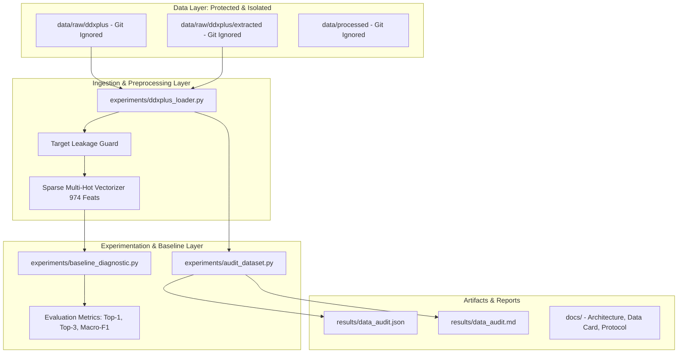

# MedResolve: System Architecture & Modular Design

## 1. Architectural Philosophy
MedResolve is organized around strict modularity, data protection, and reproducibility. Components are separated into distinct layers to allow clean benchmarking of ML classifiers before introducing scaffolded agentic logic.

---

## 2. Component Specifications

### 2.1 Dataset Loader & Preprocessor (`experiments/ddxplus_loader.py`)
- **Metadata Management:** Ingests official JSON schemas (`release_conditions.json`, `release_evidences.json`).
- **Token Canonicalization:** Establishes a deterministic vocabulary of 972 evidence tokens + 2 demographic features.
- **Sparse Encoding:** Constructs memory-efficient `scipy.sparse.csr_matrix` representations, reducing memory footprint by over 97% compared to dense matrices.
- **Data Leakage Sentinel:** Inspects feature space to guarantee that `PATHOLOGY` (target label) and `DIFFERENTIAL_DIAGNOSIS` (target probability distribution) are never included in feature vectors.

### 2.2 Dataset Auditor (`experiments/audit_dataset.py`)
- Executes streaming analysis across all splits without loading entire gigabyte-scale datasets simultaneously into RAM.
- Verifies record counts, schema conformity, distribution imbalances, age ranges, sex ratios, and differential diagnosis quality.

### 2.3 Diagnostic Baseline Engine (`experiments/baseline_diagnostic.py`)
- Supports configurable dev subset extraction (up to 50,000 samples, fixed seed).
- Compares:
  1. Majority-class baseline (`DummyClassifier`)
  2. Sparse Multinomial Logistic Regression (`SGDClassifier(loss='log_loss')`)
- Emits standardized metrics: Top-1 accuracy, Top-3 accuracy, Macro-F1, per-class Precision/Recall, and confusion matrices.

### 2.4 Source-Aware Evidence Ledger (`experiments/evidence_ledger.py`)
- Tracks patient observations with source provenance (`PATIENT_REPORTED`, `EHR_EXTRACTED_NOTE`, `LABORATORY_REPORT`, `PRIOR_PRESCRIPTION`, `ENTERED_CLINICIAN_OPINION`).
- Preserves raw extracted strings separately from canonical normalized values.
- Explicitly models missing attributes (unit, observation time) as `None` without imputation.
- Encapsulates clinician diagnostic impressions in `ClinicianOpinionItem` without declaring clinical truth.

### 2.5 Clinical Conflict Detection Engine (`experiments/conflict_detector.py`)
- Executes deterministic discrepancy checks across 6 observable categories (`VALUE_OR_UNIT_DISCREPANCY`, `TEMPORAL_DISCREPANCY`, `SOURCE_STATEMENT_DISAGREEMENT`, `LOW_CONFIDENCE_EXTRACTION`, `MISSING_INFORMATION`, `ENTERED_OPINION_DISAGREEMENT`).
- Emits structured `ConflictReportItem` records with justified severity ratings and action pathways (`USER_CONFIRMATION` vs. `QUALIFIED_CLINICAL_REVIEW`).
- Preserves temporal disease evolution (>24h apart) to prevent false-positive value contradictions.

### 2.6 Uncertainty-Aware Selective Action Policy Engine (`experiments/action_policy.py`)
- Evaluates clinical presentations across three ordinary pathways (`ASK`, `EXPLAIN`, `ABSTAIN_AND_NAVIGATE`) with an overriding safety trigger (`EMERGENCY_OVERRIDE`).
- Synthesizes explicit non-fungible signals: predictive uncertainty (normalized Shannon entropy, confidence margin gap), automated extraction confidence (OCR/parser scores), and conflict detector findings.
- Enforces strict clinical non-arbitration when clinician opinions disagree and non-fabrication when abstaining.
- Evaluated via `experiments/evaluate_action_policy.py` comparing B0 (Always Explain), B1 (Conflict-Only), and B2 (Selective Action Policy).

### 2.7 Future Planned Extensions (Phase 5)
- **Scaffolded Agent Integration**: Dynamic dialogue agent combining the Phase 4 action policy with LLM-guided patient communication.
- **RAG Verification**: Retrieval-augmented grounding against clinical guideline corpora.
