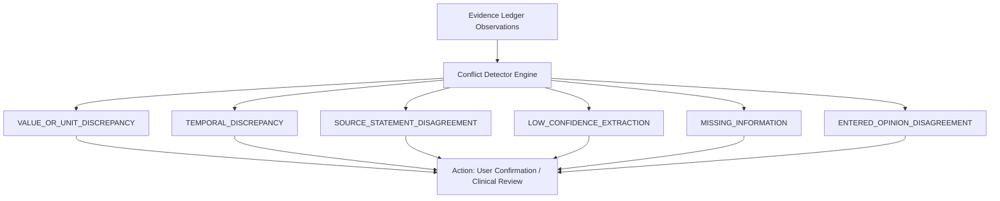

# MedResolve: Clinical Conflict Taxonomy & Discrepancy Rules

## 1. Overview
Automated diagnostic systems operating on patient-submitted multimodal data routinely encounter contradictions and uncertainties. Rather than collapsing these discrepancies into arbitrary predictions, MedResolve defines a structured **Conflict Taxonomy** comprising 6 observable data categories.

The taxonomy maintains strict epistemic boundaries: it identifies **observable data discrepancies**, not clinical causation or diagnostic ground truth.

---

## 2. Taxonomy Categories & Operational Definitions

### 1. `VALUE_OR_UNIT_DISCREPANCY`
- **Formal Definition:** Two or more records for the same clinical concept and overlapping observation timeframe contain contradictory quantitative values, incompatible units, or mutually exclusive categorical choices.
- **Clinical Example:** Patient self-reports oral temperature as 98.6 °F (37.0 °C), while a simultaneous triage nursing record documents core temperature as 103.8 °F (39.9 °C) on the same morning.
- **Severity & Action:** `HIGH` priority; triggers `USER_CONFIRMATION` or `QUALIFIED_CLINICAL_REVIEW`.
- **Boundary Constraint:** Different measurements across separate dates reflect natural disease progression (e.g., fever resolving over 4 days) and must **NOT** be flagged as value contradictions.

### 2. `TEMPORAL_DISCREPANCY`
- **Formal Definition:** Contradictions in event chronology, such as an event timestamp occurring in the future relative to the document ingestion timestamp, or impossible symptom duration sequences.
- **Clinical Example:** An outpatient progress note recorded on 2026-10-15 documents symptom onset date as 2026-10-30.
- **Severity & Action:** `MEDIUM` priority; triggers `USER_CONFIRMATION`.
- **Boundary Constraint:** Historical records documenting past events are not contradictory simply because they occurred years prior. A medication timeline must never be assumed to prove medical causation of an adverse event without clinical trial evidence.

### 3. `SOURCE_STATEMENT_DISAGREEMENT`
- **Formal Definition:** Direct contradiction between a patient self-reported assertion and an objective clinical document regarding the presence or absence of a finding during the same evaluation window.
- **Clinical Example:** Patient explicitly answers "No" to having dyspnea/shortness of breath (`evidence_status=ABSENT`), but a physician consult note from the same day documents "severe resting dyspnea observed" (`evidence_status=PRESENT`).
- **Severity & Action:** `HIGH` priority for acute red-flag symptoms (dyspnea, chest pain, neurological deficits); triggers `USER_CONFIRMATION`.
- **Boundary Constraint:** Neither source is assumed to be objectively correct. Patient perception and clinician observation diverge legitimately due to symptom intermittency, recall differences, or medical terminology confusion.

### 4. `LOW_CONFIDENCE_EXTRACTION`
- **Formal Definition:** An automated document extraction method (OCR or noisy document parser) yielded an extraction confidence score below an established operational reliability threshold ($\text{confidence} < 0.70$).
- **Clinical Example:** An OCR parser extracts Serum Hemoglobin as "12.4 g/dL" with character confidence score 0.48 due to a blurry document scan.
- **Severity & Action:** `MEDIUM` priority; triggers `USER_CONFIRMATION` with document snippet display.
- **Boundary Constraint:** Low extraction confidence indicates **document-processing uncertainty**, NOT medical falsehood or clinical abnormality. It must never be treated as evidence that the clinical finding itself is incorrect.

### 5. `MISSING_INFORMATION`
- **Formal Definition:** The absence of an essential clinical attribute strictly required for clinical interpretation, such as a quantitative laboratory value lacking its unit of measurement or an unrecorded observation timestamp on an acute vital sign.
- **Clinical Example:** A laboratory extraction reports Serum Potassium as "5.9" with `unit=None`, precluding safe risk assessment of hyperkalemia without unit verification.
- **Severity & Action:** `HIGH` priority for critical laboratory tests and vitals; triggers `QUALIFIED_CLINICAL_REVIEW`.
- **Boundary Constraint:** Missing information must be explicitly preserved as `None`/unknown. The system must never impute default values or assume standard units.

### 6. `ENTERED_OPINION_DISAGREEMENT`
- **Formal Definition:** Two distinct external clinician entries or consultation notes record divergent diagnostic impressions or conflicting differential diagnoses for the same patient presentation.
- **Clinical Example:** An urgent care clinician documents diagnostic impression as "Acute Viral Bronchitis", while a cardiology consult letter from the same day diagnoses "Congestive Heart Failure Exacerbation".
- **Severity & Action:** `MEDIUM` priority; triggers `QUALIFIED_CLINICAL_REVIEW`.
- **Boundary Constraint:** Opinion disagreement indicates clinical diagnostic ambiguity; MedResolve strictly forbids arbitrating which doctor is correct or declaring diagnostic truth.

---

## 3. Severity & Action Determination Matrix

| Conflict Category | Default Severity | Recommended Action Pathway | Clinical Rationale |
|---|---|---|---|
| `VALUE_OR_UNIT_DISCREPANCY` | HIGH | USER_CONFIRMATION | Divergent vitals/units alter triage acuity thresholds. |
| `TEMPORAL_DISCREPANCY` | MEDIUM | USER_CONFIRMATION | Chronological inversion distorts acute vs. chronic trajectory. |
| `SOURCE_STATEMENT_DISAGREEMENT` | HIGH | USER_CONFIRMATION | Direct patient vs. note conflict on acute symptoms requires patient clarification. |
| `LOW_CONFIDENCE_EXTRACTION` | MEDIUM | USER_CONFIRMATION | Visual verification of scanned snippet by patient or clinician resolves ambiguity. |
| `MISSING_INFORMATION` | HIGH / LOW | QUALIFIED_CLINICAL_REVIEW | Missing units on electrolyte/drug levels present acute clinical risk. |
| `ENTERED_OPINION_DISAGREEMENT` | MEDIUM | QUALIFIED_CLINICAL_REVIEW | Diagnostic disagreement requires clinician review, not AI arbitration. |
