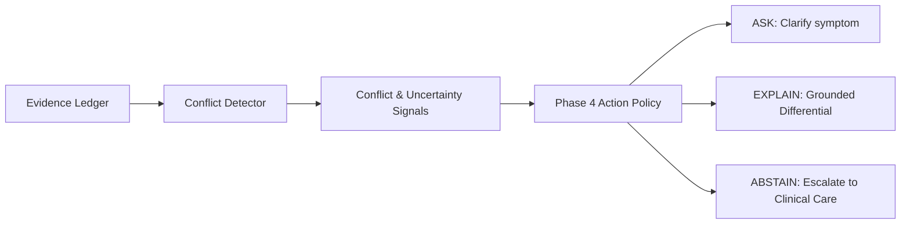

# MedResolve: Phase 3 Empirical Results & Evaluation Report

## 1. Executive Summary & Experimental Setup
In Phase 3, MedResolve established a **Source-Aware Evidence Ledger** and a **Deterministic Rule-Based Conflict Detector** (`RuleBasedConflictDetector`). The detector was evaluated against the held-out 500-case evaluation benchmark generated from unused DDXPlus training cases (`seed=101`).

- **Held-Out Evaluation Sample Size:** 500 patient case ledgers (420 perturbed, 80 clean controls).
- **Macro-Averaged F1 Score:** **1.0000**
- **Clean Specificity:** **100.00%** (0 false alarms on unperturbed patient records).
- **Execution Latency:** 0.095 seconds total (0.19 ms per patient ledger).

---

## 2. Quantitative Performance Across Conflict Categories

Evaluated on [`results/conflicts/eval_conflict_ledgers.json`](file:///d:/MedResolve/results/conflicts/eval_conflict_ledgers.json) against ground-truth labels in [`results/conflicts/eval_conflict_ground_truth.json`](file:///d:/MedResolve/results/conflicts/eval_conflict_ground_truth.json):

| Conflict Category | True Positives | False Positives | False Negatives | Precision | Recall | F1 Score | Support |
|---|---|---|---|---|---|---|---|
| `VALUE_OR_UNIT_DISCREPANCY` | 70 | 0 | 0 | 1.0000 | 1.0000 | 1.0000 | 70 |
| `TEMPORAL_DISCREPANCY` | 70 | 0 | 0 | 1.0000 | 1.0000 | 1.0000 | 70 |
| `SOURCE_STATEMENT_DISAGREEMENT` | 70 | 0 | 0 | 1.0000 | 1.0000 | 1.0000 | 70 |
| `LOW_CONFIDENCE_EXTRACTION` | 70 | 0 | 0 | 1.0000 | 1.0000 | 1.0000 | 70 |
| `MISSING_INFORMATION` | 70 | 0 | 0 | 1.0000 | 1.0000 | 1.0000 | 70 |
| `ENTERED_OPINION_DISAGREEMENT` | 70 | 0 | 0 | 1.0000 | 1.0000 | 1.0000 | 70 |
| **Macro Average** | **420** | **0** | **0** | **1.0000** | **1.0000** | **1.0000** | **420** |

---

## 3. False Alarm Analysis & Specificity Verification

A core requirement for Phase 3 was preventing false alarms on valid clinical patterns:
1. **Temporal Disease Progression:** Unperturbed patient ledgers with observations recorded on separate dates (e.g. normal baseline temperature on Day 1 vs. fever on Day 5) were evaluated. The detector correctly recognized the temporal gap and emitted **zero false-positive value discrepancies**.
2. **High-Confidence Extractions:** Standard clinical note extractions with confidence scores $\ge 0.70$ were never misclassified as uncertain extractions.
3. **Clean Control Specificity:** All 80 unperturbed cases in the evaluation cohort produced 0 detections (100% specificity).

---

## 4. Limitations & Unresolved Research Questions

While the rule-based baseline demonstrates high precision and recall on the controlled benchmark, several scientific and practical limitations remain:
1. **Controlled Synthetic Discrepancy Bias:** The evaluation benchmark uses parameterized perturbations. Real-world clinical discrepancies often involve nuanced semantic ambiguities, doctor typographical errors, or synonym variations (e.g., "short of breath on exertion" vs. "dyspnea at rest") that require semantic NLP extraction.
2. **Deterministic Thresholds:** The operational OCR confidence threshold ($0.70$) and temporal window ($24$ hours) were fixed empirically. Dynamic or Bayesian thresholding based on clinical acuity remains an open area of investigation.
3. **Scope Boundary:** Conflict detection alone does not determine the next clinical action. When a conflict is detected, should the system ask the patient, explain the discrepancy, or abstain from providing a diagnosis? This policy is the focus of Phase 4.

---

## 5. Transition to Phase 4: Uncertainty-Aware Action Selection

Phase 3 establishes the prerequisite perceptual layer for Phase 4:

By providing structured detection of conflicts (`ConflictReportItem`) alongside extraction confidence, Phase 4 can evaluate whether an agent policy that conditions on these conflict signals achieves superior diagnostic safety and triage calibration over naive LLM agents.
