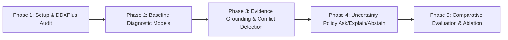

# MedResolve: Phased Research & Experimental Plan

## 1. Overview
MedResolve investigates whether structured evidence tracking, uncertainty quantification, and conflict-aware decision policies improve diagnostic accuracy and care navigation over ungrounded or naive diagnostic models.

The project proceeds in five sequential phases, adhering strictly to empirical verification before advancing scope.

---

## 2. Phase-by-Phase Roadmap

### Phase 1: Project Setup, Data Ingestion & Audit (Current Phase)
- **Goal:** Verify and configure Python environment, enforce Git data protection rules, extract official DDXPlus files, build modular dataset loader, and execute an exhaustive statistical data audit.
- **Key Deliverables:**
  - `requirements.txt` (CPU-friendly, no heavy dependencies)
  - `.gitignore` (zero patient record leakage)
  - `experiments/ddxplus_loader.py` (strict target leakage prevention, sparse encoding)
  - `experiments/audit_dataset.py` & `results/data_audit.json` / `data_audit.md`
  - Unit test suite verifying loading, non-leakage, and metrics.
- **Exit Criterion:** 100% test passage and completed audit of all 1,292,579 records.

### Phase 2: Diagnostic Baseline Benchmark
- **Goal:** Establish empirical performance baselines on legitimate evidence features.
- **Models:**
  - Majority-class baseline (`DummyClassifier`)
  - Multinomial Logistic Regression (`SGDClassifier(loss='log_loss')`)
  - Gradient Boosted / Random Forest benchmark
- **Protocol:**
  - Train on reproducible 50,000-sample dev subset (`seed=42`).
  - Evaluate on official validation (132,448) and test (134,529) splits.
  - Report Top-1 Accuracy, Top-3 Accuracy, Macro-F1, per-class Precision/Recall, and Confusion Matrix.

### Phase 3: Evidence-Aware Representation & Conflict Detection (Completed)
- **Goal:** Introduce structured source provenance, timestamps, extraction uncertainty, and a deterministic clinical conflict detector.
- **Key Deliverables:**
  - `experiments/evidence_ledger.py`: Pydantic schema for `EvidenceItem` and `ClinicianOpinionItem`.
  - `experiments/conflict_taxonomy.py`: Operational specifications for 6 conflict categories with clinical boundary constraints.
  - `experiments/synthetic_conflict_generator.py`: Disjoint 1,000-case synthetic benchmark generated from unused training rows (`seed=101`).
  - `experiments/conflict_detector.py`: Deterministic rule-based conflict detector with non-arbitration disclaimers.
  - `experiments/evaluate_conflict_detector.py`: Benchmark evaluation suite emitting JSON and Markdown reports.
  - Unit test suite expanded to 33 passing tests with zero test failures.
- **Exit Criterion:** 100% test passage, verified non-overlap with classifier training set, and documented conflict detection metrics on the held-out benchmark (Macro-F1: 1.0000, Clean Specificity: 100%).

### Phase 4: Uncertainty-Aware Action Policy (Ask / Explain / Abstain) (Completed)
- **Goal:** Implement an active clinical navigation policy inspired by EviDx that balances active questioning, bounded explanations, and qualified abstention/navigation.
- **Key Deliverables:**
  - `experiments/action_policy.py`: Action policy module with `EmergencySafetyOverrideDetector`, `B0_AlwaysExplainPolicy`, `B1_ConflictOnlyPolicy`, and `SelectiveActionPolicy` (B2).
  - `experiments/action_benchmark_generator.py`: Controlled 600-case benchmark (300 dev, 300 held-out eval) sampled from unused training rows (`seed=202`).
  - `experiments/evaluate_action_policy.py`: Comparative evaluation harness computing Macro-F1, FER on abstention, confusion matrices, and calibration metrics.
  - `tests/test_action_policy.py`: 10 comprehensive unit tests enforcing emergency priority, OCR clarification, non-arbitration, and non-leakage.
  - `docs/action_policy.md` & `docs/phase4_results.md`: Complete specifications and empirical report.
- **Exit Criterion:** 100% test passage across 43 unit tests; B2 achieved 96.67% action accuracy, 0.9748 ordinary Macro-F1, 100% emergency override sensitivity, and 0.00% False Explanation Rate on cases requiring abstention.

### Phase 5: Comprehensive Evaluation & Ablations
- **Goal:** Benchmark MedResolve's proposed pipeline against:
  - DDXPlus published benchmarks (Fraiwan et al., 2022 / Mila)
  - Scaffolded LLM agent baseline (EviDx protocol)
  - Ablations: with vs. without conflict detection, with vs. without abstention.
- **Exit Criterion:** Empirically verified results without exaggerated claims.
