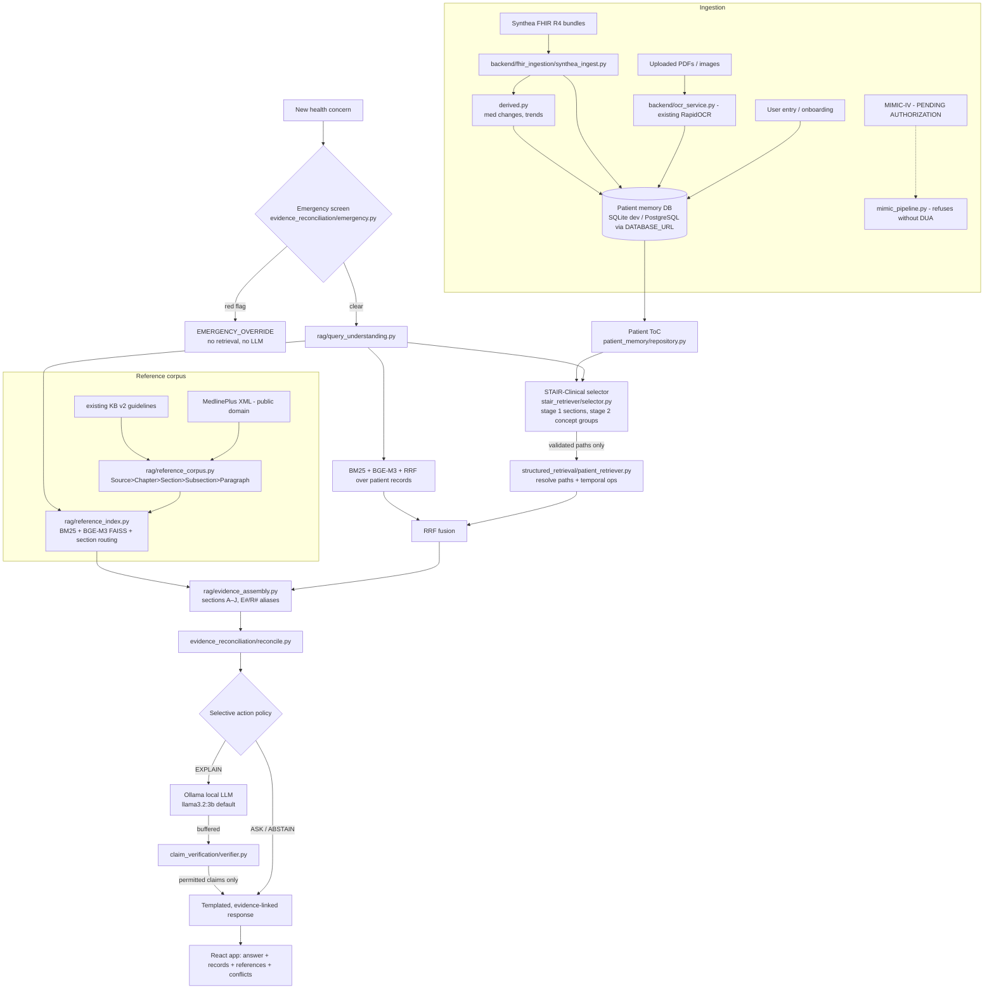

# MedResolve v2 — System Architecture

MedResolve v2 adds a longitudinal, patient-context-aware assistant to the existing research codebase. The Phase 1–6 components (`experiments/`, `backend/main.py` `/api/*` routes, and the research console at `#/research`) are kept unchanged. v2 is mounted next to them: its endpoints live under `/api/v2/*` and its patient app is the default frontend route.

## Components

| Layer | Module | Responsibility |
|---|---|---|
| Config | `backend/config.py` | DB URL, Ollama model, embedding model, STAIR backend, JWT secret (env-overridable) |
| Patient memory | `backend/patient_memory/{models,db,hierarchy,classify,derived,repository}.py` | Normalized longitudinal records, the STAIR-Clinical hierarchy, patient ToC, patient-scoped queries, medication exposure intervals |
| Ingestion | `backend/fhir_ingestion/synthea_ingest.py`, `mimic_pipeline.py` | FHIR R4 → records with provenance; data-quality report; MIMIC stub that refuses without authorization |
| STAIR | `backend/stair_retriever/{prompts,constrained,selector,training_data,sft,train_lora}.py` | Original STAIR prompt, STAIR-Clinical prompts, constrained scoring, selectors, dataset generation, LoRA training |
| Retrieval | `backend/structured_retrieval/patient_retriever.py`, `backend/rag/{fusion,embeddings,reference_corpus,reference_index}.py` | BM25, BGE-M3 (cached), RRF, structured ops, reference corpus/index |
| Generation | `backend/rag/{query_understanding,evidence_assembly,pipeline}.py`, `backend/llm/ollama_client.py` | Query understanding, context sections A–J, B0–B5 orchestration, local LLM |
| Safety | `backend/evidence_reconciliation/{emergency,reconcile}.py`, `backend/claim_verification/verifier.py` | Emergency pre-emption, conflict/missing-info findings, claim verification and gated release |
| API | `backend/api/{auth,patient_routes,services}.py` mounted in `backend/main.py` | JWT auth, patient isolation, CRUD, timeline, documents/OCR, consult (+SSE), history, export/delete |
| Frontend | `frontend/src/v2/*` (default route), `frontend/src/App.tsx` (`#/research`) | 14 patient screens; Phase 5 research console unchanged |
| Evaluation | `evaluation/experiments/{patient_context_retrieval,stair,response_evaluation}` | Retrieval protocol, SearchTome validation/baselines, B0–B5 response evaluation |

## Request path for `POST /api/v2/consult/stream`
1. `patient_id` is taken **only** from the JWT. All later reads go through `PatientMemory(session, patient_id)`.
2. The emergency screen runs first. If it triggers, the deterministic response is returned and retrieval and the LLM are skipped.
3. Query understanding extracts symptoms, medications, organ systems, intent and time range.
4. Patient retrieval runs the STAIR-Clinical selector over the patient ToC (stage 1: sections; stage 2: concept groups). Every path is validated against the patient's hierarchy, then resolved to database records with structured temporal operations, and fused with hybrid BM25+dense results via RRF.
5. Current medications and allergies are always added as safety context.
6. Reference retrieval: STAIR-style section routing over MedlinePlus/KB, then hybrid passage retrieval inside the selected sections.
7. Evidence is assembled into sections A–J, with `[E#]`/`[R#]` aliases and an epistemic status for each fact.
8. Reconciliation produces conflict and missing-information findings, and the policy selects ASK / EXPLAIN / ABSTAIN_AND_NAVIGATE.
9. For EXPLAIN, the LLM output is buffered. The claim verifier removes unverified claims, and only the verified text is streamed to the client. Raw tokens are never streamed.
10. The consultation (query, action, evidence, verification, timings, model configuration) is stored for the history screen.

## Storage
- **Database:** SQLite at `data/medresolve.db` by default. PostgreSQL works by setting `DATABASE_URL=postgresql+psycopg2://…`. No SQLite-specific SQL is used outside the optional WAL pragma. *Not yet run against a live PostgreSQL server in this environment* (Docker was unavailable and the user chose SQLite for now).
- **Vectors:** BGE-M3 embeddings are cached on disk by text SHA-1 (`models/embeddings/`). FAISS `IndexFlatIP` is used for reference passages. Patient-record dense scores are computed in memory per patient.
- **Uploads:** `data/uploads/`; each document is linked to its patient and stored as extracted records with `verification_status=unconfirmed`.
